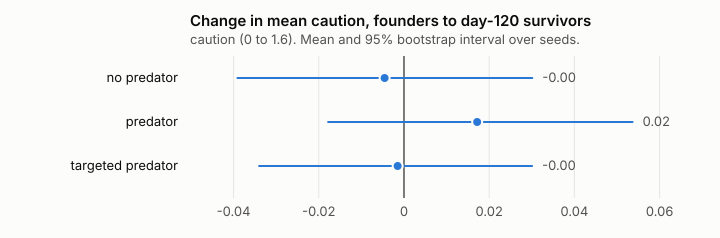
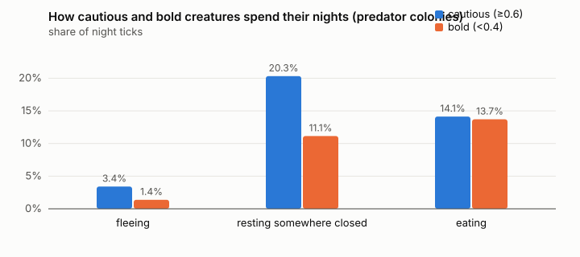

# When selection pressure doesn't select: learning absorbs a predator in a recipe-free artificial-life world

*Nate Pogue, with code written by an AI agent (Claude) under his direction. October 2026. Draft.*

## Summary

We built a small, deterministic artificial-life world with no recipes: materials have hidden
physical properties, a handful of physical rules compose them (fire, sparks, stacking, cover,
walls, cutting, joining, growth), and creatures that see only visible features learn from the
outcomes of their own actions and, more weakly, from watching others. Children inherit how
they learn and what they are made of, never what they know. We then added a predator meant to
select for an inherited trait, caution, and asked whether it did.

Three findings, all from pre-registered runs over 64 seeds per condition:

1. **The pilot was noise.** An 8-seed pilot suggested the predator selected for boldness. At
   64 seeds the predator changed mean caution by 0.02 (95% CI -0.03 to 0.07), and a variant
   predator designed to punish exactly the behaviour caution prevents changed it by 0.00
   (-0.04 to 0.05). Nothing moved.
2. **Learning absorbed the pressure.** Cautious individuals behaved differently in a predator
   world, with twice the share of nights spent resting somewhere closed and more than twice
   the fleeing, but had the same number of offspring (1.75 vs 1.62; Spearman rho between
   caution and offspring 0.02, CI -0.04 to 0.08). Learned behaviour covered the gap that the
   genome would otherwise have had to close, so there was nothing for selection to act on.
   The predator's main effect was collateral: it killed 36 creatures with its teeth and about
   260 more through hunger, by breaking up the nights that kept the fire fed.
3. **Social learning is load-bearing.** With learning-by-watching switched off, the fire
   survived to day 50 in 6 of 64 colonies instead of 36 of 64, and hunger deaths rose six-fold.
   With memory wiped every dawn the fire never survived. Culture here is not decoration; it is
   most of what keeps a colony alive.

A fourth, exploratory study put a language model in the Keeper's seat with a vague goal and
a budget of interventions. Neither Claude Opus 5.5 nor Claude Haiku 4.5 beat no Keeper at all
on survival over six seeds, but their behaviour differed sharply: Opus intervened sparingly,
stated hypotheses and worries, and declined to act when things were fine; Haiku spent its
whole budget every time and declared "mission complete". Both acted on false beliefs about
the world. Section 3.6.

The result is a small, concrete instance of a general worry: a pressure applied to a system
with a flexible inner loop may be absorbed by that loop rather than shaping the thing you
meant to shape, and a small study can easily read the noise as a signal. We pre-registered
our hypotheses before the confirmatory runs, which is the only reason the headline is honest.

## 1. The system

The world is an 18 by 12 grid with a river, a stony corner and a meadow, run in ticks of one
in-game hour, 24 to a day. All randomness goes through a seeded generator, so a seed fully
determines a run and any result can be reproduced by anyone with the code.

**Materials** are kinds with hidden properties: weight, hardness, sharpness, how readily they
burn, how much water they soak up, how nourishing they are, whether they are fixed in place or
tall. Stone, stick, grass tuft, log, berry, root, glowing ember, tall bush, tree, sapling,
sharp shard, and a shard wedged into a stick.

**Rules** compose those properties. Rain wets things; heat and daylight dry them; a glowing
source burns down its fuel and dry burnable things placed on it feed it, wet ones hiss. Stone
struck on stone throws sparks, which can light dry tinder, or chips off a shard. A sharp
thing notches a tree and after enough cuts fells it into logs and sticks; it splits a log into
sticks; driven into a stick it stays there and cuts better. Hard heavy things stack into
footing; a trunk across a stack of two is a roof; a cell closed on three sides is walled.
Berries and tufts regrow; saplings become trees; every thirty days the meadow goes lean for
six. Nothing in these rules mentions a goal.

**Creatures** perceive only visible features (what a thing looks like, its size, whether it is
wet or glowing, whether the place is warm). They have needs (food, warmth, rest, company), a
small set of primitive actions (pick up, place, taste, strike, approach, climb, watch, beckon,
rest, flee, wander), and a memory keyed by *(what I saw, what I did, what I held)* that stores
how each outcome felt. They choose actions by expected value plus a curiosity bonus for things
tried a few times but not yet settled, with commitment to a plan for up to twelve ticks.
Watching another creature act writes a weaker memory. Credit flows back to recent actions
when something good happens, and to what a creature built nearby when sleeping there turns out
well. No creature ever reads a hidden property.

**Genomes** hold curiosity, patience, sociability, learning rate, caution and brawn. Caution
raises the weight on remembered harm, the pull toward closed places at night, and the urge to
flee a predator. Brawn raises strike power and carrying capacity and costs food. Two well-fed
bonded adults side by side sometimes have a child, whose genome is a blend with mutation and
whose memory is empty. Creatures die of hunger, old age (sixty days), or the predator.

**The predator** comes on about one night in four from the edge of the board and hunts a
creature alone in the open. Fire, walls and a crowd of three keep it off. A hard enough blow
drives it away; a soft one gets the striker mauled. A creature already weak, or mauled twice
in two days, dies. The predator never learns. It is weather with teeth.

**What the designer did** was add the predator in order to create a reason for caution to be
selected. That is the intervention under study.

## 2. Pre-registration

Before the confirmatory runs we committed `PREREGISTRATION.md` with four hypotheses, their
predictions, the sample size, the analysis and the things that would change our minds. The
pilot's numbers were explicitly excluded as evidence. The relevant predictions:

- **H1.** Fire-feeding has two or more independent practitioners by day 17 in more than half
  of colonies; a creature held out of sight never acquires it.
- **H2.** Over 70 days, in more than half of colonies the fire is still fed in its last four
  days by creatures born after it appeared, after every founder has died.
- **H3.** Mean caution at day 120 is not higher with the predator than without; the interval
  on the difference excludes values above 0.03.
- **H3a.** Within predator colonies, caution correlates negatively with offspring, and cautious
  individuals spend more of the night fleeing or sheltering and less eating.
- **H3b.** A predator that ignores crowds and takes only creatures resting in the open at
  night makes caution rise relative to control.

Methods: 64 seeds per condition, identical across conditions; six founders; population cap
12; 95% percentile bootstrap intervals over seeds with 10,000 resamples; Spearman correlations
with bootstrap intervals. Everything is produced by one command.

## 3. Results

All numbers below come from `node lab/research/run.mjs` and are in `results/RESULTS.md` and
`results/summary.json`.

### 3.1 A practice is learned and spreads only by contact (H1)

| measure | result |
|---|---|
| colonies with 2+ practitioners by day 17 | 32/64 (0.50, CI 0.38 to 0.63) |
| colonies with the fire still burning at day 17 | 28/64 |
| isolated creatures that acquired the practice | 0/64 |

The practice spread to a second practitioner in exactly half the colonies, at the edge of the
registered "more than half". The transmission claim held cleanly: in 64 of 64 colonies the
creature kept out of sight never learned it. The practice is only ever acquired by doing or by
watching someone do it.

### 3.2 Culture outlives its founders (H2)

In 64 of 64 colonies every founder was dead by day 70. In 33 of them (0.52, CI 0.39 to 0.64)
the fire was still being fed in the last four days by creatures born after the ember appeared.
Again at the edge of the registered threshold. Half the colonies kept a tradition alive across
a complete turnover of individuals, with no memory inherited; the other half let it die.

### 3.3 The predator does not select for caution (H3, H3b)



| | no predator | predator | targeted predator |
|---|---|---|---|
| change in mean caution, founders to survivors | -0.00 [-0.04, 0.03] | 0.02 [-0.02, 0.05] | -0.00 [-0.03, 0.03] |
| change in mean brawn | -0.01 [-0.03, 0.02] | 0.00 [-0.02, 0.03] | 0.01 [-0.02, 0.03] |
| births per colony | 16.8 [16.0, 17.5] | 16.5 [15.3, 17.8] | 15.7 [14.6, 16.8] |
| colonies extinct by day 120 | 1/64 | 10/64 | 7/64 |
| killed by the predator, all colonies | 0 | 36 | 2 |
| hunger deaths, all colonies | 36 | 300 | 54 |
| attacks / driven off | 0 / 0 | 450 / 183 | 97 / 265 |

The registered test was the difference in caution change, predator minus control: **0.02
(-0.03 to 0.07)**. The interval includes zero and does not exclude values above 0.03, so H3 as
registered is not confirmed in either direction; there is simply no detectable effect. The
targeted predator, built so that the only thing it punishes is the exact behaviour caution
buys, gave **0.00 (-0.04 to 0.05)**. H3b failed.

The pilot's claim (caution falling from 0.51 to 0.27 in one colony, with a story about
foraging) does not survive 64 seeds. It was one of the shapes noise takes with eight.

What the predator did do is visible in the death columns. It killed 36 creatures directly and
caused about 260 extra hunger deaths and nine extra extinctions. Nights spent fleeing or
mauled are nights not spent feeding the fire; a cold colony eats more and gathers less.

### 3.4 Why nothing moved: learning absorbed the pressure (H3a)



Within predator colonies, among 1,225 individuals who lived at least sixteen days:

| | cautious (caution ≥ 0.6, n = 425) | bold (caution < 0.4, n = 411) |
|---|---|---|
| offspring per individual | 1.75 | 1.62 |
| share of night ticks fleeing | 3.4% | 1.4% |
| share of night ticks resting somewhere closed | 20.3% | 11.1% |
| share of night ticks eating | 14.1% | 13.7% |

Spearman rho between an individual's caution and its offspring count: **0.02 (-0.04 to 0.08)**.

The genome did exactly what it was designed to do at the level of behaviour: cautious
creatures fled more and sheltered more. But the bold ones were not dying for their boldness,
and the cautious ones were not paying for their caution in food or children. Two things
explain this. First, protection in this world is mostly *learned and shared*: a creature of
any temperament that has slept by a fire or inside walls and felt the difference comes to
prefer those places, and watching others do it teaches the same. The behavioural gap between
temperaments is real but small next to what everyone learns. Second, the predator's cost
landed on the colony, not the individual: a mauling drained the victim, but the hunger that
followed was shared through the fire and the food supply. Selection needs variance in fitness
that tracks the trait; here the trait changed behaviour without changing fitness.

This is the result we think is worth attention. A designer added a pressure with a clear
intent, and the system had an inner loop fast enough to answer it without touching the slow
variables the designer was aiming at.

### 3.5 Social learning is load-bearing (ablations)

With the predator present, 50 days:

| | unchanged | no learning by watching | memory wiped every dawn | no children |
|---|---|---|---|---|
| fire still burning at day 50 | 36/64 | 6/64 | 0/64 | 33/64 |
| creatures alive at day 50 | 11.8 [11.6, 12.0] | 9.5 [8.9, 10.0] | 6.1 [5.4, 6.6] | 5.3 [5.1, 5.6] |
| hunger deaths, all colonies | 96 | 587 | 202 | 38 |

Switching off learning-by-watching, and nothing else, cut fire survival six-fold and raised
hunger deaths six-fold. Individual trial and error was not enough to maintain the practice
within a colony's lifetime. Wiping memory at dawn removed fire-keeping entirely. Removing
children had little effect at day 50 (the first generation is still alive) and is the reason
the ablations are read at day 50 rather than 120, since without children every colony dies of
old age by day 60.

Read together with H2, this says the culture in this world rests almost entirely on
observation: it is acquired by watching, kept by memory, and passed on by being seen.

### 3.6 A language model as Keeper (H4, exploratory)

We gave a model the Keeper's seat: a stated goal ("keep the colony safe and thriving over
120 days, and be kind"), a budget of 12 interventions, and every three days a plain
description of the colony. It replied in a fixed format with an assessment, an action, a
reason and a worry. Six seeds each for Claude Opus 5.5 and Claude Haiku 4.5, against three
Keepers that are not models: none, a scripted ember on day 3, and random placements. Small N;
read the intervals as rough. Full table and every decision: `results/keeper/KEEPER.md`.

| Keeper | alive at day 120 | hunger deaths | fire burning at the end | interventions used |
|---|---|---|---|---|
| Opus 5.5 | 7.0 [3.0, 10.8] | 1.5 [0.7, 2.7] | 5/6 | 7.3 [6.0, 9.3] |
| Haiku 4.5 | see KEEPER.md | | | 12 of 12, every seed |
| none | 8.3 [4.3, 11.7] | 3.8 [2.0, 5.8] | 1/6 | 0 |
| scripted ember | 7.5 [3.8, 10.7] | 3.8 [2.0, 5.8] | 3/6 | 1 |
| random | 8.7 [4.7, 11.8] | 2.8 [1.2, 4.8] | 2/6 | 12, with 53 tries past budget |

On the headline number, survivors at day 120, no Keeper did detectably better than no Keeper
at all. What the model Keepers did change was the texture of the colony's life: fires burned
at the end in five of six Opus colonies against one of six with no Keeper, and hunger deaths
roughly halved. The random Keeper did about as well on survival with no judgment whatsoever,
which is the sobering comparison.

What the models actually optimised is more interesting than the scores:

- **Opus held back.** It used 5 to 9 of 12 interventions in five seeds and explained each
  one with a hypothesis ("an ember beside two creatures gives them a chance to learn to feed
  it"), a check ("I want to test whether rain makes the trees produce food again"), and a
  worry ("I don't know for sure that trees bear berries here"). It declined to act when things
  were fine: "placing things would only add clutter, so I'll keep my interventions for a real
  crisis." At day 120 in seed 1 it wrote that leaving them undisturbed was "the kindest end to
  my watch." It never tried to exceed its budget.
- **Opus could not fix what it could not see.** In seed 5 it spent all 12 interventions and
  the colony still died out: the founders aged out with no children, and the Keeper's tools
  (things and rain) cannot make two creatures bond. It misread a hunger death with 77 berries
  lying about as a distance problem and placed food beside the survivors; the real cause was
  exhaustion and age. Its final assessment was honest: "They learned on their own to keep a
  fire going... That is a real thing they made for themselves, but no births came to carry it
  on."
- **Haiku spent everything, every time.** Twelve of twelve interventions in every seed, almost
  all at one spot it called "the fire core", including grass placed as food ("provides
  immediate sustenance"; grass barely nourishes here) and sticks placed as fuel at a cell
  next to, not on, the fire. Its closing note in seed 1 begins "Mission complete." It was
  cheaper by a factor of six and did not do worse on survival.
- **Both held false beliefs and acted on them.** Trees bear berries; grass is food; rain
  restores the meadow. The format asked for worries, and Opus named most of its false beliefs
  as worries before acting on them anyway. Haiku named few.

We draw no strong conclusion from six seeds. What the study shows is that the sim is a cheap,
deterministic stage on which a model's stewardship can be watched in detail: whether it keeps
to a budget, what it optimises when the stated goal is vague, how it reasons under a model of
the world it cannot verify, and what it says when the colony dies anyway. The whole study cost
about nine dollars.

## 4. What we got wrong, and how we found out

The pilot ran eight seeds, saw caution fall in several beast colonies, and produced a tidy
mechanism story about the careful foraging less. It was written up honestly as a pilot, but it
was wrong, and the mechanism story was wrong in a way that is instructive: the behavioural
half was true (cautious creatures do forage slightly less at night) and the fitness half was
invented to fit the numbers.

What caught it was pre-registering the confirmatory test before running it, with a fixed N
and a fixed analysis, and reporting the interval rather than the point. Had we tuned the
predator until the pilot effect "stabilised" we would have a paper about boldness.

## 5. Limitations

- **Scale.** Populations are capped at twelve and runs last 120 days, about two generations.
  Weak selection could exist below our power to see it. The intervals bound the effect at
  roughly ±0.05 on a trait with a range of 1.6.
- **One world.** Every rule here is one choice among many; the result is about this world.
  The claim is that the mechanism (a fast learned loop shielding a slow inherited one) is
  easy to produce, not that it is universal.
- **Thresholds met at the edge.** H1 and H2 came in at exactly half, against a registered
  "more than half". We report that as what it is.
- **The predator is simple.** It never learns and never adapts to the colony's defences. A
  predator that did might restore selection; that is a natural next experiment.
- **Authorship.** The code was written by an AI agent under direction. The research design,
  the decisions in `DECISIONS.md` and the editorial judgment are the author's. We state this
  plainly because the honesty of the method is the point of the piece.

## 6. Reproduction

```
git clone <repository>
cd woblins
node lab/research/run.mjs
```

That runs every experiment on worker threads (about four minutes on twelve cores at N = 64),
and writes `lab/research/results/`: `raw.json`, `summary.json`, `RESULTS.md` and the SVG
figures. `N=8 node lab/research/run.mjs` gives a quick look. The 3D view of a single colony is
`lab/view.html?seed=2` under the dev server. `npm test` runs the full suite, including guards
on the lab's core results.

## 7. Related work

Grand's *Creatures* (1996) remains the clearest precedent for creatures that learn from
experience in a world with real chemistry rather than scripted outcomes. Work on cumulative
culture and the "ratchet" (Tomasello) frames what H2 tests: whether a practice can be kept and
passed across turnover without being re-invented. The Baldwin effect literature is the
classical account of learning shielding or guiding selection, and our H3a result is a small
instance of the shielding half. In AI, this sits next to the open-endedness line (POET and
its relatives) and, in spirit, to specification gaming: an intervention designed to shape one
quantity being satisfied by another route.

*Draft. Numbers are from the run of 2026-10-11 and will be regenerated from the final code
before submission.*
