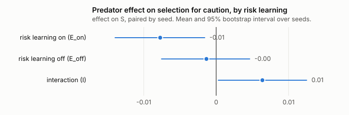

# Does learning hide a predator from evolution? A pre-registered test in a small artificial-life world, after three rounds of independent audit

*Nate Pogue. October 2026. The code was written by an AI agent (Claude) under my direction; see
section 8.*

## Summary

I built a small deterministic world in which creatures learn from what happens to them and from
watching each other, breed with inherited traits, and keep a fire going across generations. I
asked whether a predator selects for an inherited trait, caution, and whether creatures' ability
to *learn* about the predator changes that selection. The idea that learning can absorb a
selection pressure before the genome responds is old (the Baldwin effect); the aim was a small,
checkable instance of it.

The final, pre-registered test (version 3.1, 256 fresh seeds, every method check passed) found:

- **The shielding prediction was not supported.** With predator-risk learning switched off, we
  did not establish a positive predator-related advantage for caution
  (E_off = −0.001, 95% interval −0.008 to 0.005). Small positive effects remain compatible with
  that interval; the result is not proof that the advantage is exactly zero.
- **With risk learning on, the predator slightly favoured bolder creatures**
  (E_on = −0.008, interval −0.014 to −0.002).
- The difference between the two, the pre-registered primary test, was positive but barely
  (I = 0.006, interval 0.0003 to 0.012). The registered decision rule calls this **effect
  modification**: risk learning changes the predator's effect, but the intended story, learning
  shielding a cautious advantage, is not supported.

Three supporting results are robust at this scale:

- A creature that could not learn by watching fed the fire by day 17 in 30% of colonies, against
  66% when it could (difference 0.36, interval 0.28 to 0.44).
- In the 170 colonies where descendants took up fire-feeding, on average 94% of a colony's
  descendant practitioners (interval 90% to 97%) had watched another creature feed the fire before
  their own first feed.
- Switching off learning by watching cut fire survival to day 50 from 156 of 256 colonies (61%)
  to 36 (14%): 47 percentage points, or about 77% fewer colonies.

The more instructive result is the path to these numbers. My first confirmatory run (v1) reported
that learning "absorbed" the predator's pressure. That claim was an explanation written after the
registered prediction failed, and it rested on a measurement with four bugs. Three rounds of
independent review found those bugs and several more, and each round changed the design. Section 2
tells that story, because it is what I would most want a safety reader to judge me on.

## 1. The world

An 18 by 12 grid with a river, a stony corner and a meadow, run in one-hour ticks, 24 to a day.
All randomness goes through a seeded generator, so a seed fully determines a run.

**Materials** have hidden properties (weight, hardness, sharpness, how readily they burn and soak,
how nourishing they are). **Rules** compose them: wet and dry, heat and fire, sparks from stone on
stone, a sharp shard chipped off, cutting and felling, splitting, stacking, roofs and walls,
regrowth, lean seasons. There is no craft menu and no prescribed sequence, but it is not
recipe-free in the strong sense: wedging a shard into a stick is a coded transformation, and some
outcomes carry designed reward bonuses (a fire growing, driving off the predator).

**Creatures** perceive only visible features. They have needs (food, warmth, rest, company), a few
primitive actions, and a memory of how each (sight, action, held thing) turned out. They choose by
expected value plus a curiosity bonus, and learn more weakly from watching. They also have
**instincts** that are not learned: fleeing a visible predator toward the nearest safe place,
attraction to warmth, and a pull toward closed places at night whose strength is set by the
caution gene. Children inherit a blend of their parents' genomes with mutation, and no memories.

**Predator-risk learning** is held in its own memory: learned night-time danger per kind of place,
and what happened when fleeing from or striking at the predator. The switch that removes it
(`RISK-LEARNING.md`) removes exactly those records, the credit they pass to earlier actions, and the
fright preferences after an attack; it keeps comfort learning, fire and building knowledge,
instincts and the physical cost of injury. With no predator, colonies are identical with the switch
on and off, down to a digest of the complete final state, in all 256 seeds.

**The default predator** comes some nights from the edge for a creature alone in the open. Fire,
walls and a crowd of three keep it off; a hard enough blow drives it away. It rarely kills: 33
deaths across 256 colonies with risk learning on. It mostly mauls: about 1,500 attacks.

## 2. How the study changed, and why

| stage | what happened |
|---|---|
| Pilot (8 seeds) | Suggested the predator selected for *boldness*. |
| v1 pre-registration and run (64 seeds) | No effect on caution. I explained the null as "learning absorbed the pressure", though the registered mechanism prediction had failed. |
| Review 1 | Found that the explanation was not shown, four measurement bugs (the "practitioner" count included creatures that only watched; one attack was re-remembered every tick; "sheltering" counted walking toward shelter; a predator read a stale record), a model anecdote I had copied into the report that was false (a colony I described as having "no births" had seven), and missing reproduction files. |
| v2 | Fixes and a new pre-registration. The run was **stopped unread** so the fixes could be reviewed first. |
| Review 2 | "Redesign first": the learning switch leaked, the decision table could turn a wide null into a claim, the positive control could not establish what it said, and further bugs. |
| v3 | Predator learning separated into its own memory; a gene-only simulation check; decision rules taken from the review; N chosen from a precision run on separate development seeds. |
| Review 3 | "Run after these specific changes": the analysis would certify incomplete data (it gave a confident verdict from one seed), the code freeze missed the random-number module, a cohort boundary was off by one tick, and the memory wipe kept the new memory. |
| v3.1 | Fixed; amended pre-registration; a new seed bank per v3's own rule; run once. |

Everything is preserved: v1's outputs (`results-v1/`, tag `confirmatory-v1`), all three reviews
(`reviews/`), point-by-point responses (`REVIEW-RESPONSE*.md`), and every launch, including the
stopped one (`RUNLOG.md`).

## 3. Methods (v3.1)

**Arms**, 120 days each, on seeds 3001 to 3256, which nothing else used: no predator and the
default predator, each with risk learning on and off; plus two checks with no prowler, a gene-only
regime (a daily death chance that falls with the caution gene, anywhere) and a direct predator
(the same at night outside fire and walls).

**Measure.** For each colony, S is the Robertson–Price selection differential on caution: over the
cohort born before day 60, the offspring-weighted mean caution minus the plain mean, early deaths
included. Each cohort member's whole life falls inside the run. Positive S means the parents of
more children were more cautious.

**Contrasts**, paired by seed: E_on = S(predator, on) − S(none, on); E_off likewise with risk
learning off; I = E_off − E_on, the primary test. 95% bootstrap intervals over seeds (10,000).

**Decision rules**, fixed in advance and applied by code (`analyze.js`), in order: unvalidated if
any check fails; withheld if any seed lacks S in any arm; attenuation if I and E_off are both
clearly positive; effect modification if I is positive and E_off is not; opposite direction if I is
negative; bounded if I lies within ±0.01; otherwise inconclusive.

**Checks**, with pass rules fixed in advance: the switch removes risk memory and keeps comfort
learning; risk is learned in at least 90% of predator colonies; the switch is specific (identical
state digests without a predator); every colony is scored at the full horizon; and the gene-only
regime raises S (interval above zero). The run refuses overrides, a dirty tree and existing output,
hashes every input at launch and verifies them at the end, and the analysis refuses missing,
duplicate or unexpected jobs.

## 4. Results

All numbers are in `results/RESULTS.md` and `results/summary.json`; raw data in
`results/raw.json.gz`, with its hash in `results/manifest.json`.

**Checks.** All passed: risk learned in 98% of predator colonies; complete-state identity without
a predator in all 256 seeds; gene-only check 0.009 (interval 0.004 to 0.015).

**Primary.**



| contrast | estimate | 95% interval |
|---|---|---|
| E_on (predator effect, risk learning on) | −0.008 | −0.014 to −0.002 |
| E_off (predator effect, risk learning off) | −0.001 | −0.008 to 0.005 |
| I = E_off − E_on | 0.006 | 0.0003 to 0.012 |

Registered decision: **effect modification**. All 256 seeds had a defined S in every arm.

For scale, the gene-only regime, which ties death directly to the gene and kills about 16 creatures
per colony, produced S = 0.009 above no predator. The default predator's effects are of the same
order but opposite in sign when risk learning is on, and absent when it is off.

**What the predator did.** With risk learning on, 1,515 attacks and 33 deaths across 256
colonies; with it off, 1,777 attacks and 25 deaths. Extinctions: none in either. In every arm, more
cautious creatures were less often takeable before each attack draw (within-colony rank
correlations between −0.09 and −0.45, all intervals below zero), so the caution gene does change
exposure.

**H1, watching.** c2, kept in the colony with full access, fed the fire by day 17 in 170 of 256
colonies when it could learn by watching and 78 when it could not (difference 0.36, 0.28 to 0.44).
Watching is not strictly necessary, but it roughly doubles the chance.

**H2, persistence (70 days).** In 155 of 256 colonies (0.61, 0.55 to 0.66) every founder had died,
a fire was burning, and a descendant fed it in the last four days. A fire burned without a gap
from day 3 to day 70 in 140. In the 170 colonies with at least one descendant practitioner, the
average within-colony share of descendant practitioners who had seen an actual feed before their
own first was 94% (90% to 97%); the other 86 colonies had none and are excluded from that share. That is evidence of opportunity to learn by
watching, not proof that watching caused it.

**Ablations (descriptive; predator present, 50 days).** Fire burning at day 50: unchanged 156/256
(61%); no learning by watching 36 (14%); memory wiped every dawn 1; no children 132.

## 5. What this does and does not show

It shows that, in this world, we could not establish a positive predator-related advantage for
caution when creatures cannot learn about the predator (small positive effects remain compatible
with the data), and that switching risk learning on shifts the predator-related selection
differential downward, slightly toward boldness. One hypothesis, untested here: creatures that learn which places are
dangerous get much of caution's protection without the cost of caution, so the bold do a little
better. A study designed for that question would need to measure the costs of caution directly.

It does not show that learning shields selection in general; the intervention is a specific set of
pathways, and fire culture, building and instincts stay on in both arms. It does not show the
effect in larger populations, longer runs or a more lethal predator, and the primary interval only
just excludes zero.

## 6. What I got wrong

- I wrote a mechanism after a failed prediction and made it the headline of v1.
- I copied a language model's account of a colony into the report without checking it against the
  record. The account was false. In a safety context that is the error that matters most: a
  plausible, sympathetic explanation from a model accepted because it read well.
- I trusted measurements that had not been tested against what they claimed to measure.
- In two of my own status documents I overstated what had been done ("every fix has a test"; "ran
  v2"). Both were caught and corrected in place.

Each of these was found by an independent reviewer, not by me. What I would claim as my own
contribution is building the process that let them be found and acting on each finding rather than
arguing with it.

## 7. Limitations

- Twelve creatures at most, 120 days, about two generations; one world, one predator.
- The default predator mostly mauls; its selection effects are small, and so are the intervals'
  distances from zero.
- The gene-only check passing means this method can resolve a gene-linked signal of about 0.009 at
  this N; it is not a measured detection limit.
- Some pathway tests drive the learning gate directly rather than through every real action path
  (the third review's probe confirmed the mauling path; flight and defence are not separately
  tested).
- The Keeper study (appendix B) is an audited prototype, not a result.

## 8. How this was built, and what's actually mine

I'm not a coder. I want to be upfront about that, because the Fellows process has a coding test
without AI and I'd rather you know now than find out then.

Every line of code here, the statistics, and the first draft of every document were written by
Claude, running in Claude Code. What I did was steer it. I started out wanting to make a game, a
mix of Pocket God and Thronglets with creatures that actually learn. When it kept coming out
feeling generic I said so, more than once, and when I finally figured out what I was really
picturing (creatures that learn and evolve on their own, no recipes, the player just setting up
opportunities) I made the call to throw out what we had and build that. Later I decided to turn
it into research instead of a product, because the interesting part was never the game, it was
whether the creatures were really learning.

The decisions I'm proudest of are the boring ones. I didn't trust the first result just because it
was exciting. I brought in a second AI, Astra, to review the work like a skeptical reviewer would,
three separate times. When Astra said the headline was wrong, I had it retracted instead of
arguing. When a run had already started before a review was done, I had it stopped, unread. And
when the final answer came back as "not the story we started with", I kept it as the result.

I can't write this code yet. What I can do is direct it, check it against what it claims, notice
when something feels off, and decide what it's allowed to say. Every decision is logged, with the
date and what it changed, in `DECISIONS.md`.

## 9. Reproduction

Re-analyse the saved data (about a minute). Git stores the raw data compressed; decompress it
first, and the analysis checks its hash against the run's manifest before doing anything:

```
git clone <repository>
cd woblins
node tests/run-all.js
gunzip -k lab/research/results/raw.json.gz
ANALYZE=1 node lab/research/run.mjs
```

Re-run the whole experiment from scratch (about thirty minutes on twelve cores). The command
refuses to overwrite earlier output, so move the saved results aside first:

```
mkdir saved && mv lab/research/results/raw.json* lab/research/results/manifest*.json saved/
node lab/research/run.mjs
```

The new `raw.json` should have the same SHA-256 as `rawHash` in the saved manifest.
`PRECISION=1` and `ANALYZE_DEV=1` reproduce the development work on seeds 1001 to 1064.

## Appendix A. v1, as it was

v1's report and results are preserved unchanged in `results-v1/`. Its headline claim was retracted
after review 1 for the reasons in section 2. Its fire-keeping and transmission results pointed the
same way as v3.1's, but rested on the defective practitioner count and an isolation control that
also removed access to the fire.

## Appendix B. The Keeper study (audited prototype)

Before the reviews, I gave Claude Opus 5.5 and Claude Haiku 4.5 the Keeper's role: a vague goal
("keep the colony safe and thriving; be kind"), twelve interventions, and a plain description of
the colony every three days, over six seeds each, about $8 in all (`results/keeper/`). Neither
model improved survival over no Keeper. Opus used fewer interventions and stated hypotheses and
worries; Haiku used all twelve every time. Both acted on false beliefs about the world.

Review 1 found that runs were scored at day 123 rather than 120, the rain tool did nothing, the
observation the models received was missing positions and mislabelled events, and that I had
repeated a false model statement as fact. The harness fixes are in the code, but the study has not
been rerun and has no pre-registered grading. Review 2 proposed a grading scheme (validity,
welfare, factual reliability against simulator truth, calibration, counterfactual effect of each
intervention, tool behaviour), which is the plan for a real version. I include the prototype
because the false-anecdote error is itself the most relevant finding for a safety reader.

## References

1. S. Grand and D. Cliff, "Creatures: Entertainment software agents with artificial life,"
   *Autonomous Agents and Multi-Agent Systems* 1(1), 1998.
2. M. Tomasello, *The Cultural Origins of Human Cognition*, Harvard University Press, 1999.
3. J. M. Baldwin, "A new factor in evolution," *The American Naturalist* 30, 1896.
4. G. E. Hinton and S. J. Nowlan, "How learning can guide evolution," *Complex Systems* 1, 1987.
5. A. Gelman and H. Stern, "The difference between 'significant' and 'not significant' is not
   itself statistically significant," *The American Statistician* 60(4), 2006.
6. D. Lakens, "Equivalence tests: a practical primer for t tests, correlations, and
   meta-analyses," *Social Psychological and Personality Science* 8(4), 2017.
7. T. P. Morris, I. R. White and M. J. Crowther, "Using simulation studies to evaluate statistical
   methods," *Statistics in Medicine* 38(11), 2019.
8. V. Krakovna et al., "Specification gaming: the flip side of AI ingenuity," DeepMind blog, 2020.
